# Copertine originali per XTEINK X3

Una galleria di **47 illustrazioni originali** in bianco e nero, preparate come schermate di sospensione per XTEINK X3 con CrossPoint. Figure, animali e luoghi escono dalle pagine di un libro aperto. Le immagini sono state create con OpenAI ImageGen e adattate allo schermo del lettore.

Le immagini **19–47** corrispondono, una per titolo, ai **29 titoli distinti** di Stephen King trovati sulla microSD usata per questo progetto. I due EPUB duplicati di *Al crepuscolo* e *On Writing* condividono la rispettiva copertina. Sono compresi due libri firmati Richard Bachman e due collaborazioni.

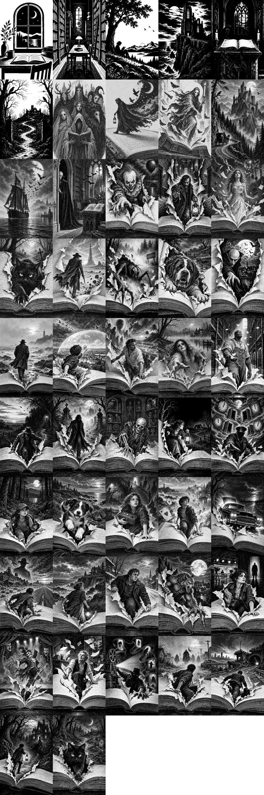

## Uso sul lettore

1. Spegni l’X3 ed estrai la microSD.
2. Copia uno o più file `.bmp` dalla cartella [`copertine/`](copertine/) nella cartella `/.sleep/` alla radice della scheda. Su macOS la cartella `.sleep` può essere nascosta.
3. Espelli la scheda in sicurezza, reinseriscila nell’X3 e scegli **Custom** nelle impostazioni della schermata di sospensione di CrossPoint.

Le illustrazioni sono **immagini per la sospensione**: non vengono associate automaticamente all’EPUB corrispondente e non cambiano la copertina incorporata nel libro.

## File

- [`copertine/`](copertine/): 47 BMP Windows 3.x non compressi, **528 × 792 pixel, 24 bit**, pronti per `/.sleep/`.
- [`anteprime/`](anteprime/): le stesse 47 immagini in PNG per questa galleria GitHub.
- [`indice.csv`](indice.csv): corrispondenza tra numero, titolo, ispirazione e nome dei file.
- [`anteprima-galleria.png`](anteprima-galleria.png): panoramica compatta dell’intera raccolta.

Per mostrare la galleria su GitHub, **decomprimi l’archivio e carica `README.md` insieme alle cartelle e ai file**, mantenendo questa struttura. Caricare soltanto il file ZIP non rende visibile la galleria nella pagina del repository.

## Galleria

### Lettura

<table>
<tr>
<td align="center"><a href="copertine/01-lettura-notturna.bmp">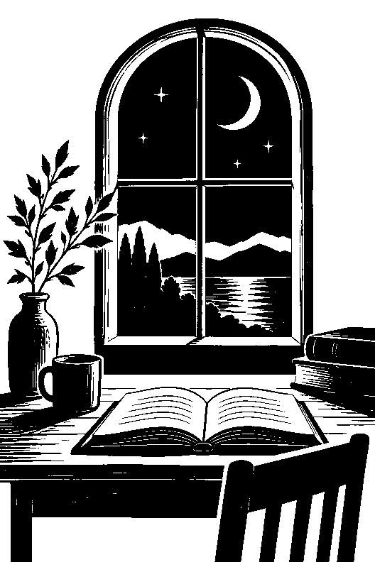</a> <strong>01 · Lettura notturna</strong> <small>Tema originale</small></td>
<td align="center"><a href="copertine/02-biblioteca.bmp">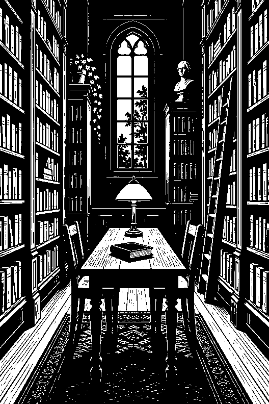</a> <strong>02 · Biblioteca</strong> <small>Tema originale</small></td>
<td align="center"><a href="copertine/03-lettura-all-aperto.bmp">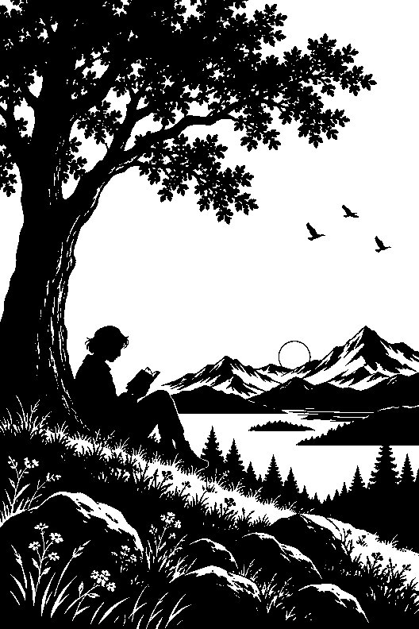</a> <strong>03 · Lettura all&#x27;aperto</strong> <small>Tema originale</small></td>
</tr>
</table>

### Gotico e horror

<table>
<tr>
<td align="center"><a href="copertine/04-torre-gotica.bmp">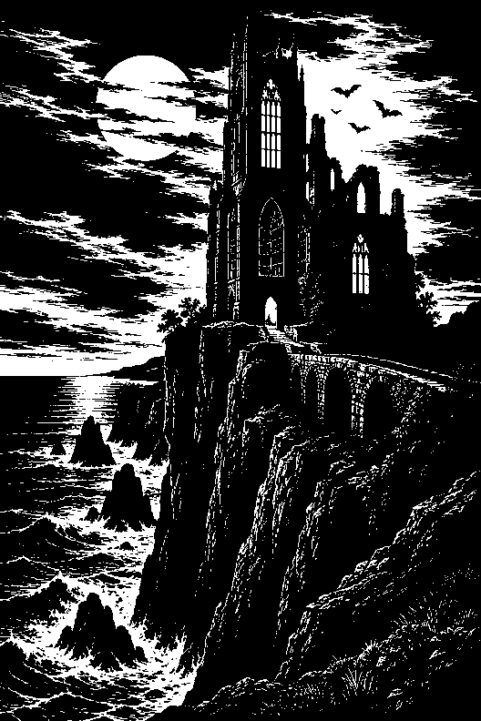</a> <strong>04 · Torre gotica</strong> <small>Tema originale</small></td>
<td align="center"><a href="copertine/05-libro-e-corvo.bmp">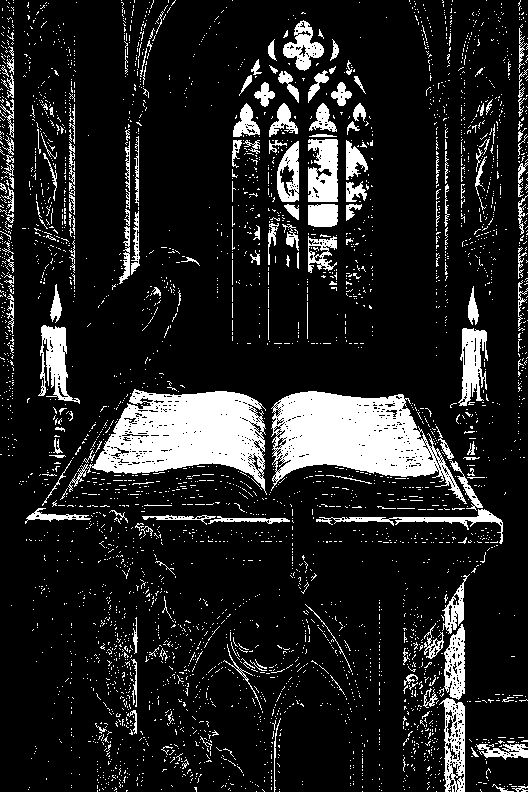</a> <strong>05 · Libro e corvo</strong> <small>Tema originale</small></td>
<td align="center"><a href="copertine/06-sentiero-del-maniero.bmp">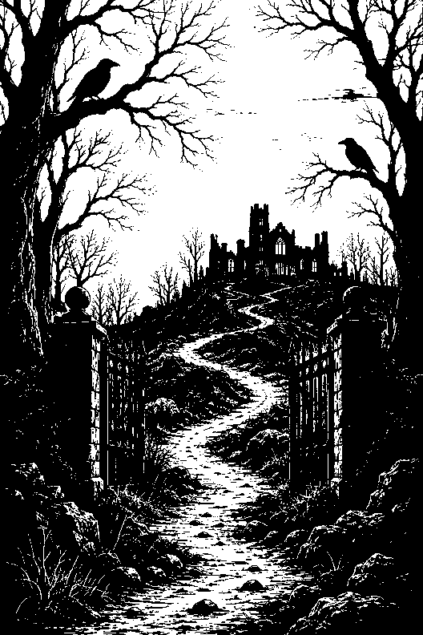</a> <strong>06 · Sentiero del maniero</strong> <small>Tema originale</small></td>
<td align="center"><a href="copertine/07-corte-delle-ombre.bmp">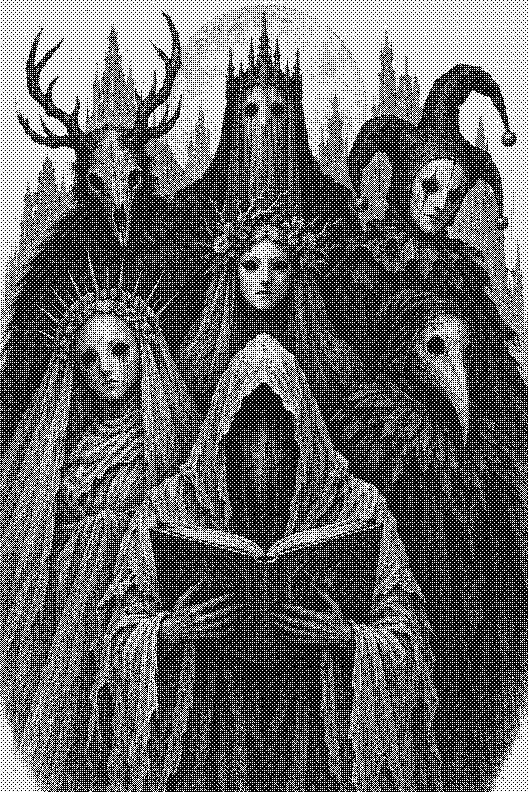</a> <strong>07 · Corte delle ombre</strong> <small>Tema originale</small></td>
</tr>
<tr>
<td align="center"><a href="copertine/08-viandante-delle-stelle.bmp">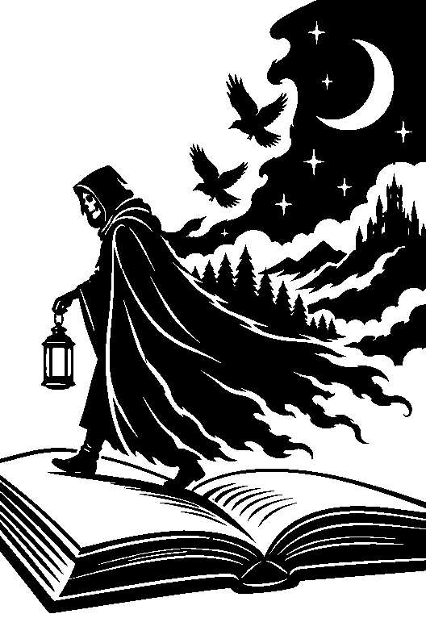</a> <strong>08 · Viandante delle stelle</strong> <small>Tema originale</small></td>
<td align="center"><a href="copertine/09-spettro-delle-pagine.bmp">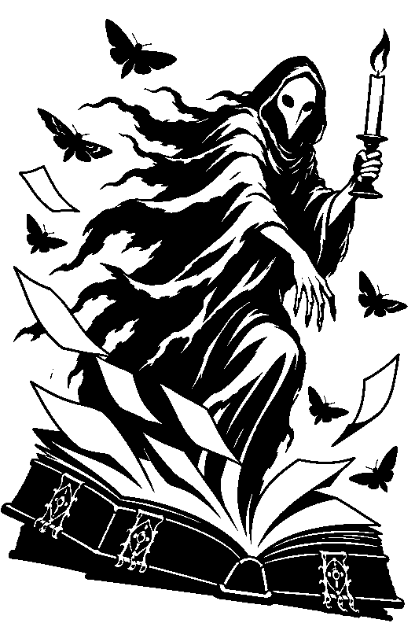</a> <strong>09 · Spettro delle pagine</strong> <small>Tema originale</small></td>
</tr>
</table>

### Dracula di Bram Stoker

<table>
<tr>
<td align="center"><a href="copertine/10-castello-dei-carpazi.bmp">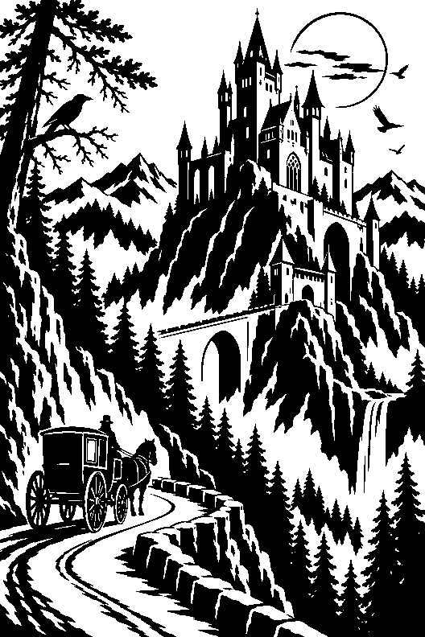</a> <strong>10 · Castello dei Carpazi</strong> <small>Dracula di Bram Stoker</small></td>
<td align="center"><a href="copertine/11-la-demeter.bmp">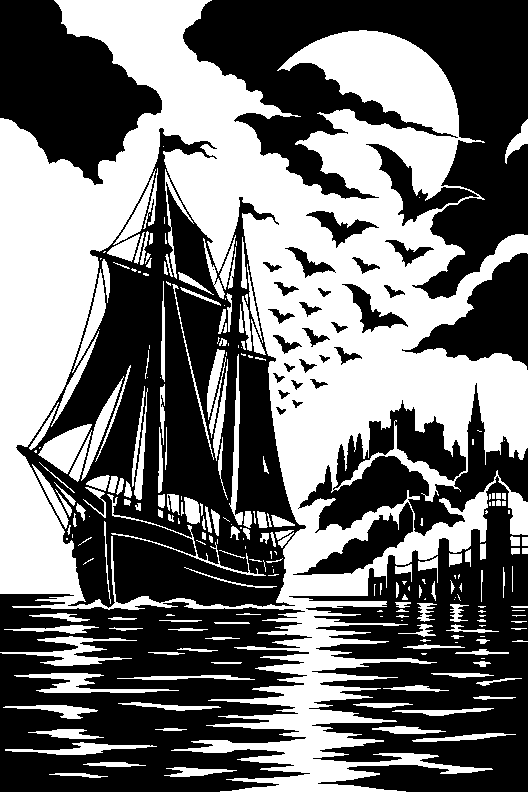</a> <strong>11 · La Demeter</strong> <small>Dracula di Bram Stoker</small></td>
<td align="center"><a href="copertine/12-il-conte-nella-biblioteca.bmp">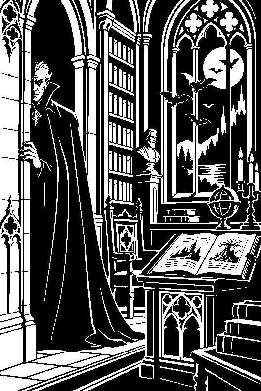</a> <strong>12 · Il conte nella biblioteca</strong> <small>Dracula di Bram Stoker</small></td>
</tr>
</table>

### Stephen King — prima serie

<table>
<tr>
<td align="center"><a href="copertine/13-it-il-clown.bmp">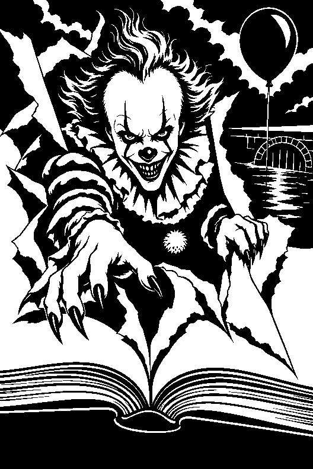</a> <strong>13 · It — Il clown</strong> <small>Opere di Stephen King</small></td>
<td align="center"><a href="copertine/14-shining-il-custode.bmp">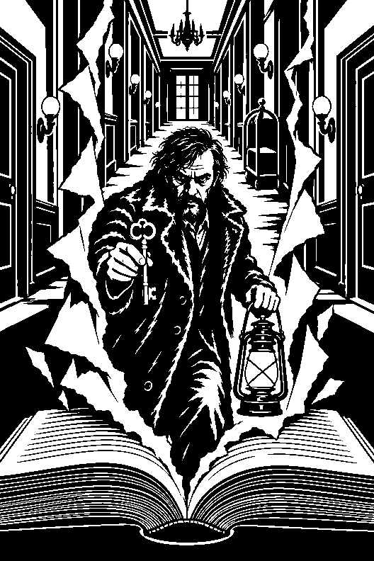</a> <strong>14 · Shining — Il custode</strong> <small>Opere di Stephen King</small></td>
<td align="center"><a href="copertine/15-carrie-la-telecinetica.bmp">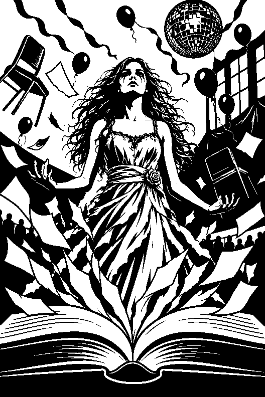</a> <strong>15 · Carrie — La telecinetica</strong> <small>Opere di Stephen King</small></td>
<td align="center"><a href="copertine/16-pet-sematary-il-gatto.bmp">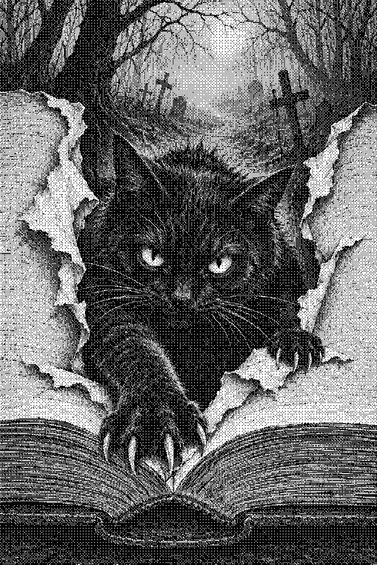</a> <strong>16 · Pet Sematary — Il gatto</strong> <small>Opere di Stephen King</small></td>
</tr>
<tr>
<td align="center"><a href="copertine/17-la-torre-nera-il-viandante.bmp">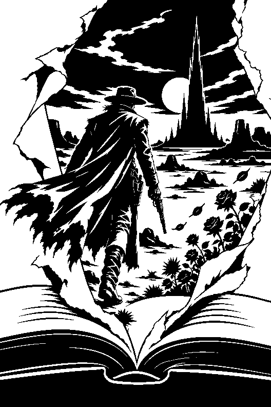</a> <strong>17 · La torre nera — Il viandante</strong> <small>Opere di Stephen King</small></td>
<td align="center"><a href="copertine/18-la-nebbia-la-creatura.bmp">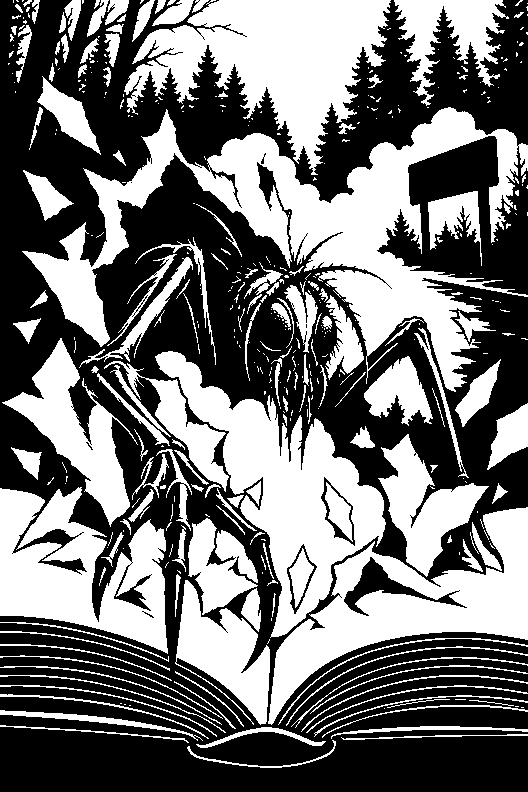</a> <strong>18 · La nebbia — La creatura</strong> <small>Opere di Stephen King</small></td>
</tr>
</table>

### Stephen King — titoli presenti sulla microSD

<table>
<tr>
<td align="center"><a href="copertine/19-cujo.bmp">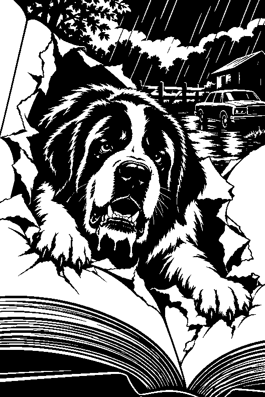</a> <strong>19 · Cujo</strong> <small>Stephen King</small></td>
<td align="center"><a href="copertine/20-le-notti-di-salem.bmp">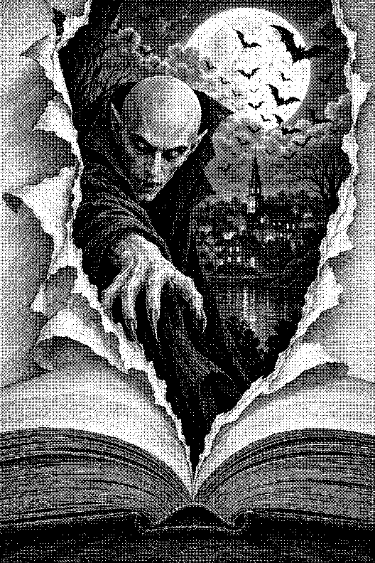</a> <strong>20 · Le notti di Salem</strong> <small>Stephen King</small></td>
<td align="center"><a href="copertine/21-colorado-kid.bmp">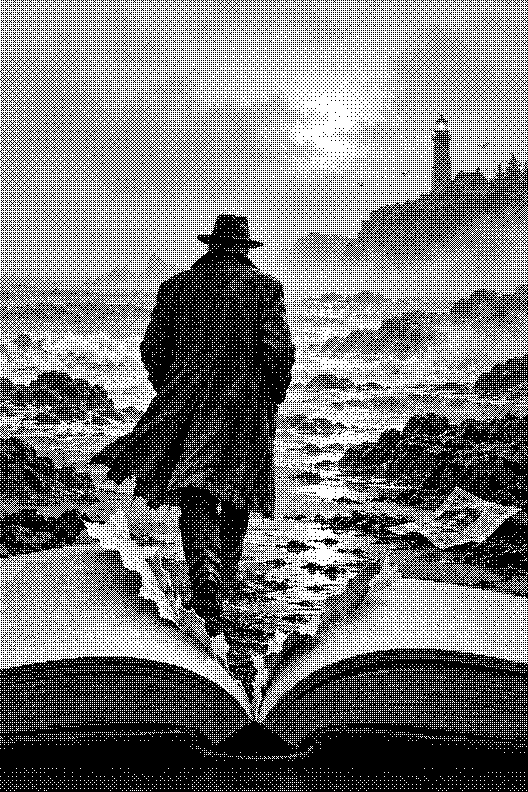</a> <strong>21 · Colorado Kid</strong> <small>Stephen King</small></td>
<td align="center"><a href="copertine/22-the-dome.bmp">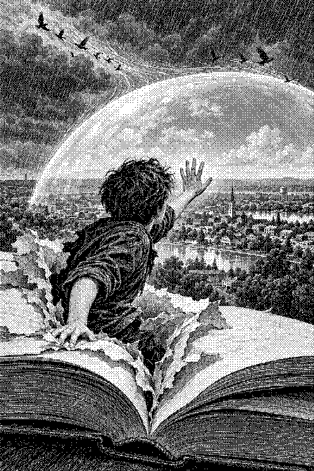</a> <strong>22 · The Dome</strong> <small>Stephen King</small></td>
</tr>
<tr>
<td align="center"><a href="copertine/23-duma-key.bmp">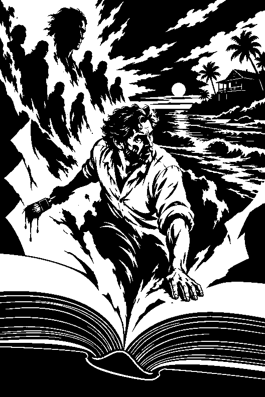</a> <strong>23 · Duma Key</strong> <small>Stephen King</small></td>
<td align="center"><a href="copertine/24-mucchio-dossa.bmp">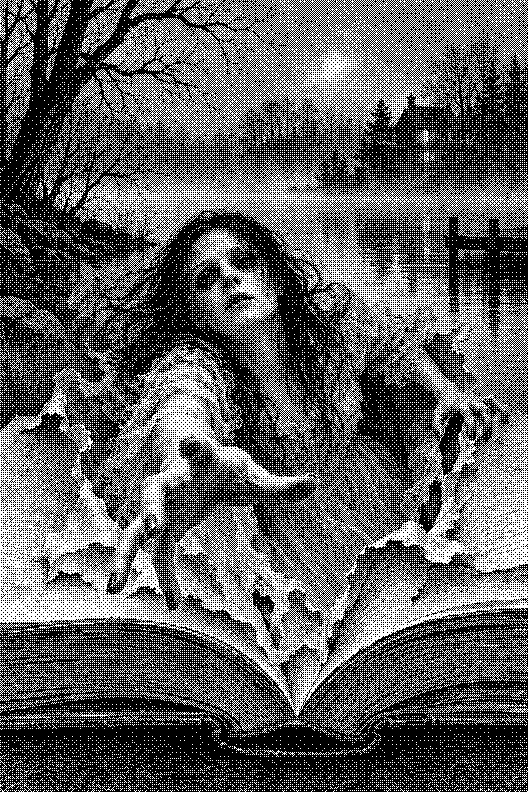</a> <strong>24 · Mucchio d&#x27;ossa</strong> <small>Stephen King</small></td>
<td align="center"><a href="copertine/25-il-miglio-verde.bmp">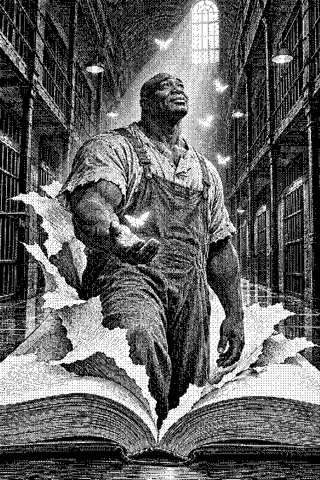</a> <strong>25 · Il miglio verde</strong> <small>Stephen King</small></td>
<td align="center"><a href="copertine/26-al-crepuscolo.bmp">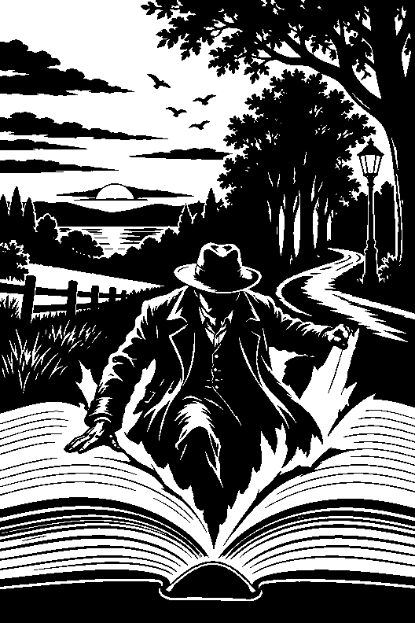</a> <strong>26 · Al crepuscolo</strong> <small>Stephen King</small></td>
</tr>
<tr>
<td align="center"><a href="copertine/27-a-volte-ritornano.bmp">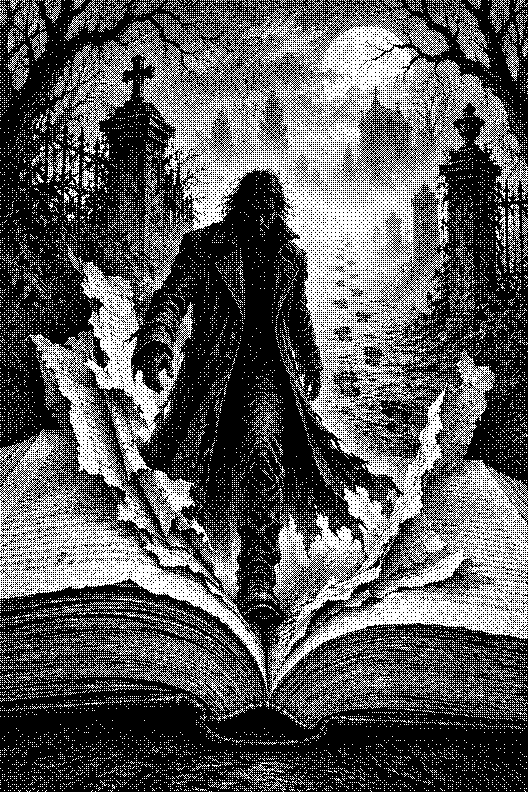</a> <strong>27 · A volte ritornano</strong> <small>Stephen King</small></td>
<td align="center"><a href="copertine/28-scheletri.bmp">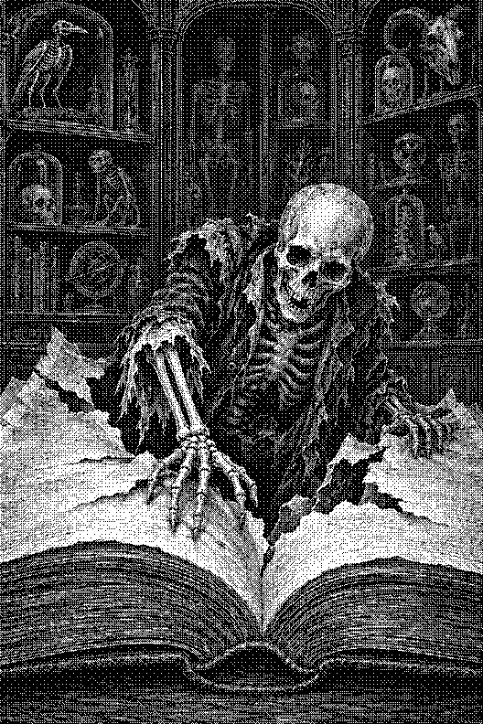</a> <strong>28 · Scheletri</strong> <small>Stephen King</small></td>
<td align="center"><a href="copertine/29-notte-buia-niente-stelle.bmp">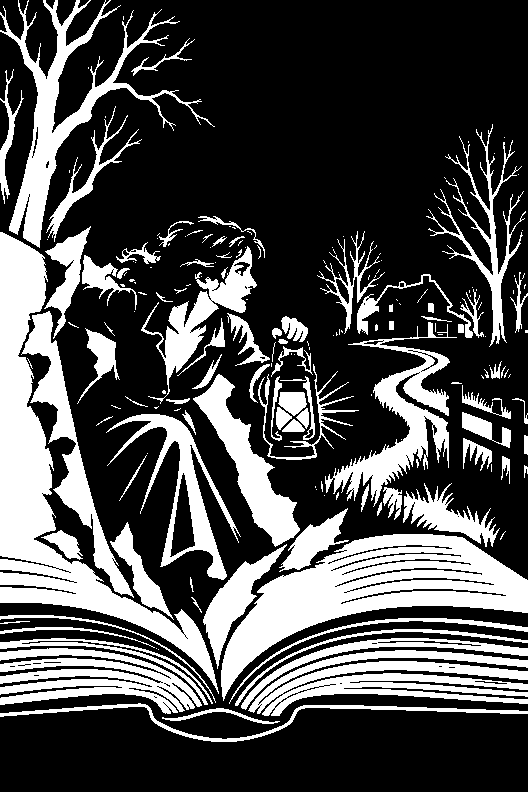</a> <strong>29 · Notte buia, niente stelle</strong> <small>Stephen King</small></td>
<td align="center"><a href="copertine/30-quattro-dopo-mezzanotte.bmp">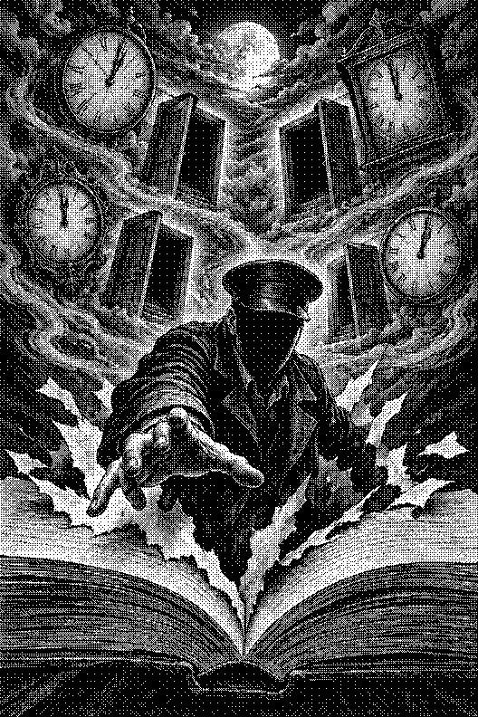</a> <strong>30 · Quattro dopo mezzanotte</strong> <small>Stephen King</small></td>
</tr>
<tr>
<td align="center"><a href="copertine/31-la-bambina-che-amava-tom-gordon.bmp">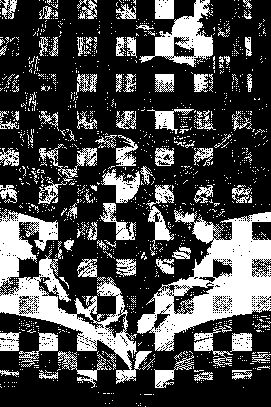</a> <strong>31 · La bambina che amava Tom Gordon</strong> <small>Stephen King</small></td>
<td align="center"><a href="copertine/32-laurie.bmp">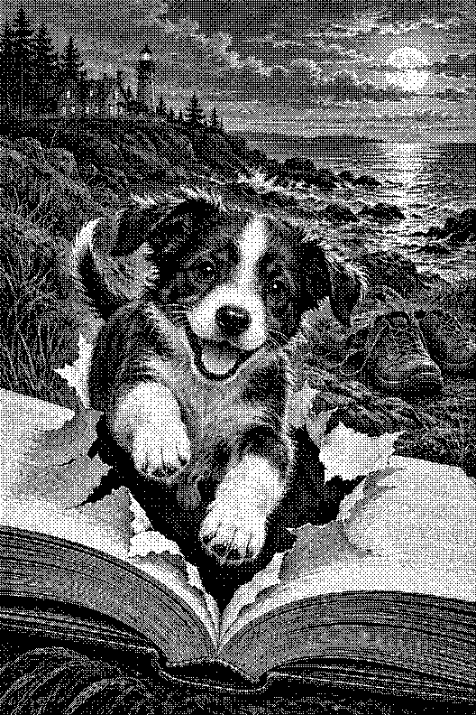</a> <strong>32 · Laurie</strong> <small>Stephen King</small></td>
<td align="center"><a href="copertine/33-la-scatola-dei-bottoni-di-gwendy.bmp">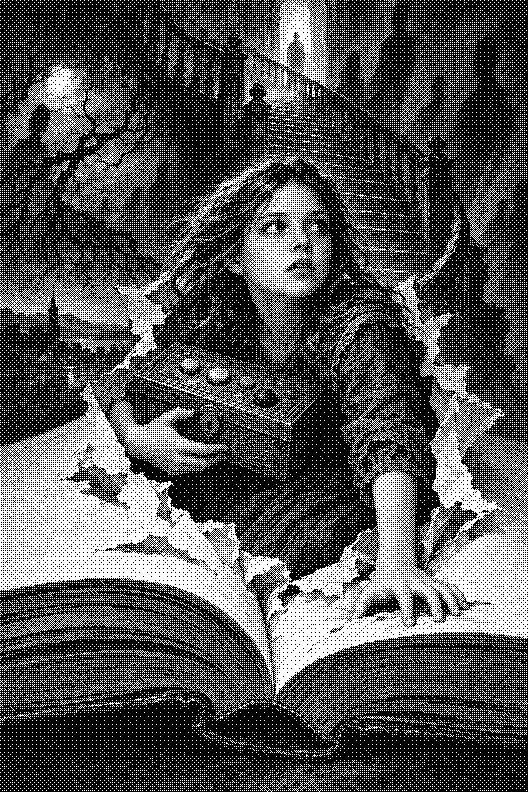</a> <strong>33 · La scatola dei bottoni di Gwendy</strong> <small>Stephen King e Richard Chizmar</small></td>
<td align="center"><a href="copertine/34-cuori-in-atlantide.bmp">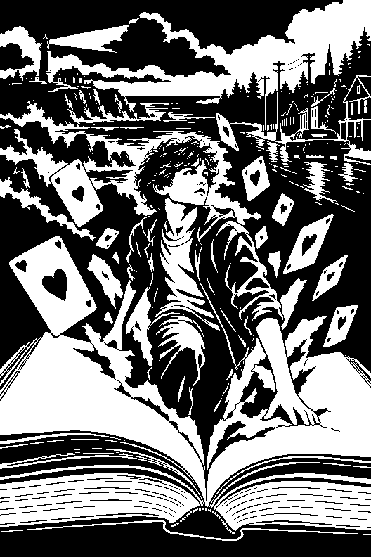</a> <strong>34 · Cuori in Atlantide</strong> <small>Stephen King</small></td>
</tr>
<tr>
<td align="center"><a href="copertine/35-buick-8.bmp">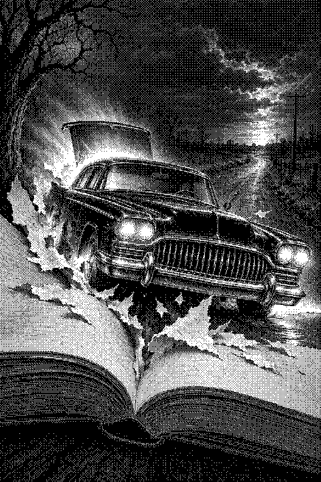</a> <strong>35 · Buick 8</strong> <small>Stephen King</small></td>
<td align="center"><a href="copertine/36-desperation.bmp">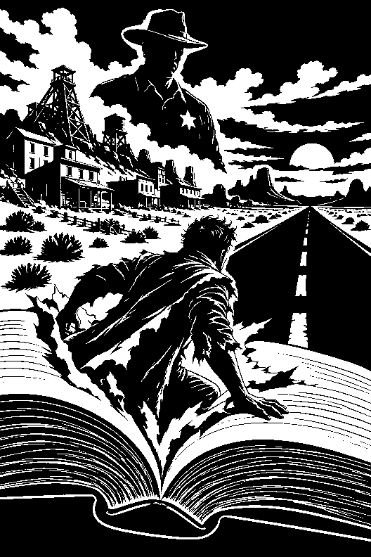</a> <strong>36 · Desperation</strong> <small>Stephen King</small></td>
<td align="center"><a href="copertine/37-dolores-claiborne.bmp">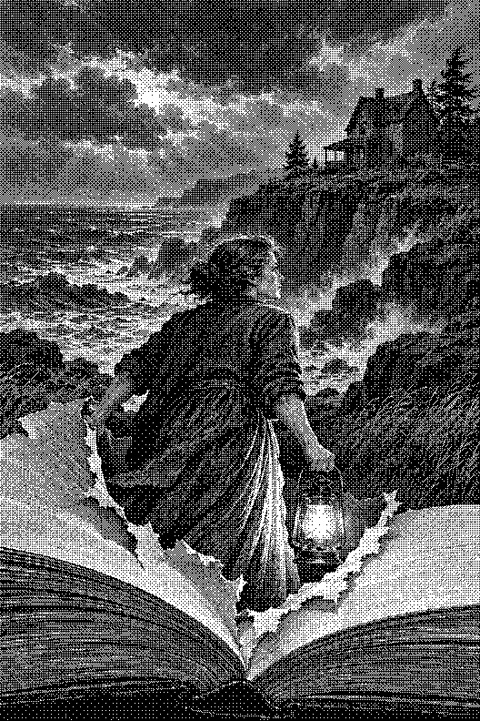</a> <strong>37 · Dolores Claiborne</strong> <small>Stephen King</small></td>
<td align="center"><a href="copertine/38-blaze.bmp">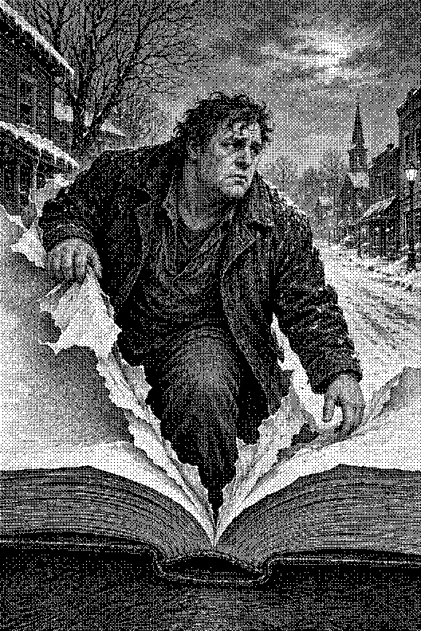</a> <strong>38 · Blaze</strong> <small>Stephen King</small></td>
</tr>
<tr>
<td align="center"><a href="copertine/39-unico-indizio-la-luna-piena.bmp">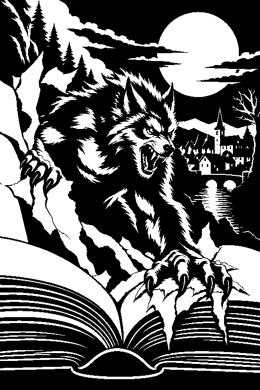</a> <strong>39 · Unico indizio la luna piena</strong> <small>Stephen King</small></td>
<td align="center"><a href="copertine/40-se-scorre-il-sangue.bmp">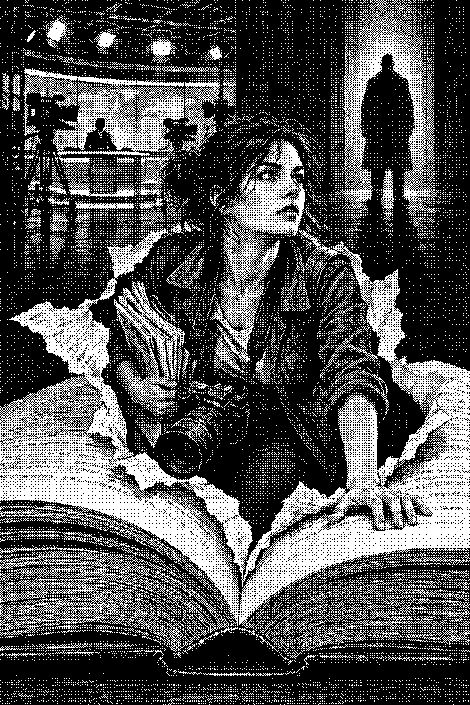</a> <strong>40 · Se scorre il sangue</strong> <small>Stephen King</small></td>
<td align="center"><a href="copertine/41-danse-macabre.bmp">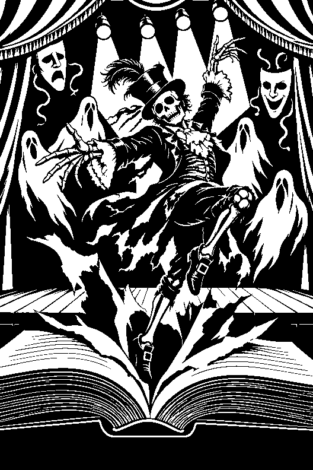</a> <strong>41 · Danse Macabre</strong> <small>Stephen King</small></td>
<td align="center"> <strong>42 · On Writing - Autobiografia di un mestiere</strong> <small>Stephen King</small></td>
</tr>
<tr>
<td align="center"><a href="copertine/43-stephen-king-goes-to-the-movies.bmp">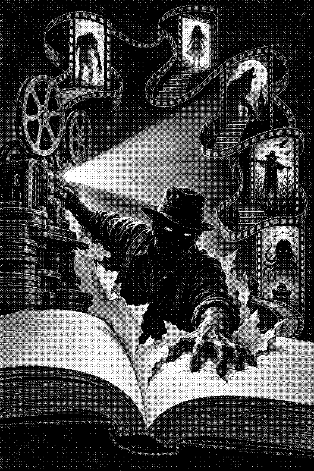</a> <strong>43 · Stephen King goes to the movies</strong> <small>Stephen King</small></td>
<td align="center"><a href="copertine/44-i-vendicatori.bmp">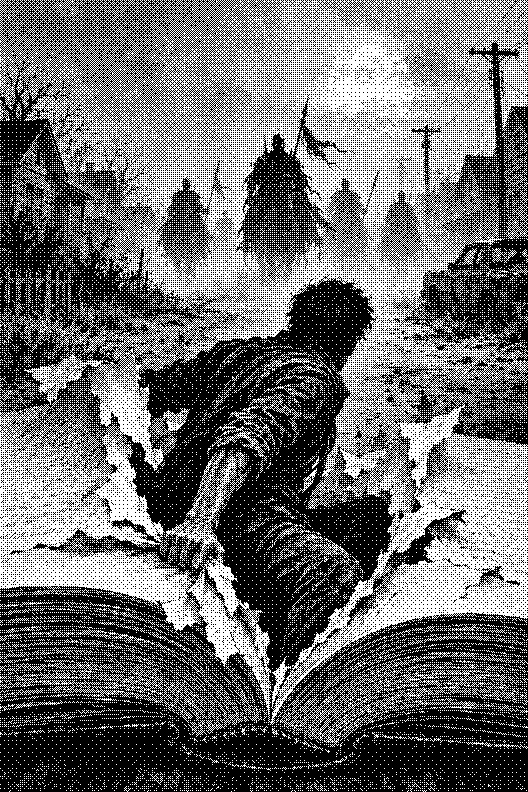</a> <strong>44 · I vendicatori</strong> <small>Richard Bachman (Stephen King)</small></td>
<td align="center"><a href="copertine/45-uscita-per-linferno.bmp">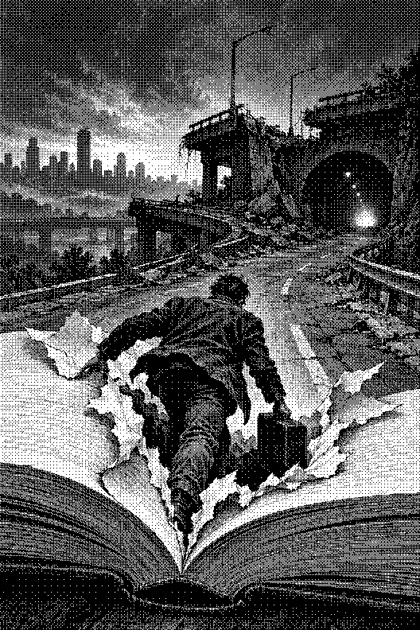</a> <strong>45 · Uscita per l&#x27;inferno</strong> <small>Richard Bachman (Stephen King)</small></td>
<td align="center"><a href="copertine/46-la-casa-del-buio.bmp">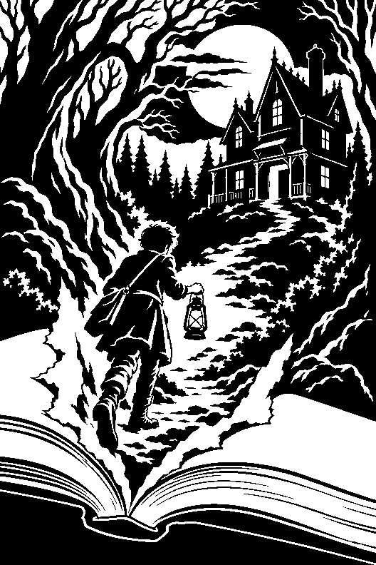</a> <strong>46 · La casa del buio</strong> <small>Stephen King e Peter Straub</small></td>
</tr>
<tr>
<td align="center"><a href="copertine/47-pet-sematary.bmp">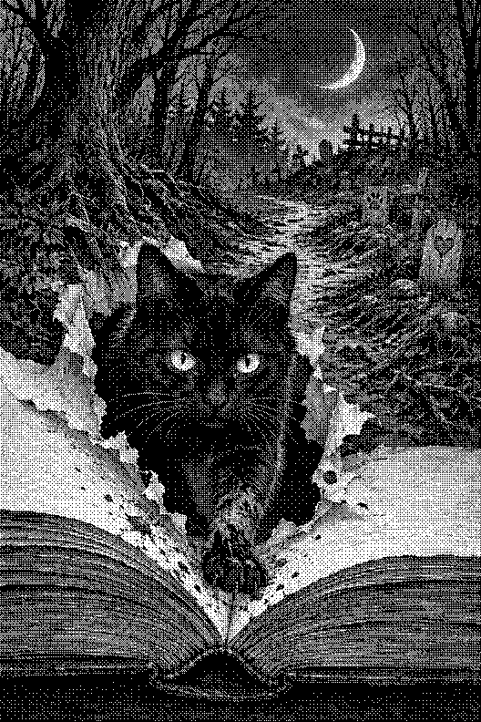</a> <strong>47 · Pet Sematary</strong> <small>Stephen King</small></td>
</tr>
</table>

## Nota sul progetto

Questa è una raccolta indipendente di immagini originali ispirate a temi letterari e titoli di libri. **Non sono copertine editoriali ufficiali** e non riproducono immagini di copertine o volti degli adattamenti cinematografici. Titoli, autori, XTEINK e CrossPoint sono citati solo per descrivere l’ispirazione e la compatibilità d’uso.
